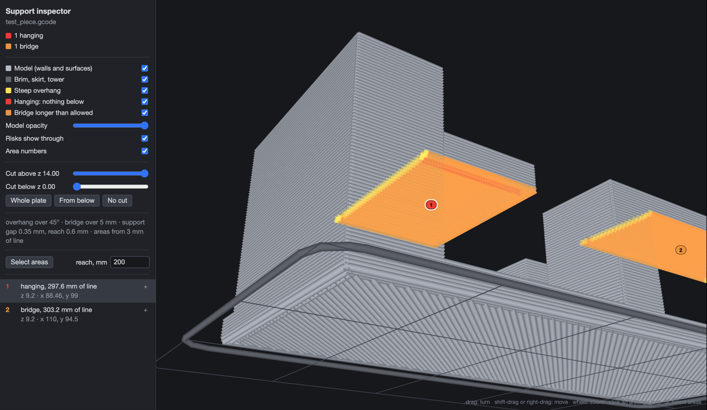
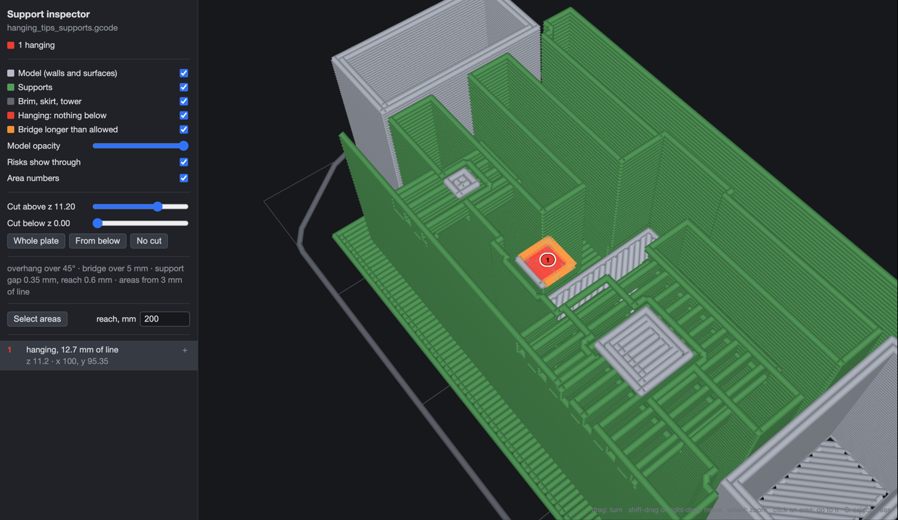
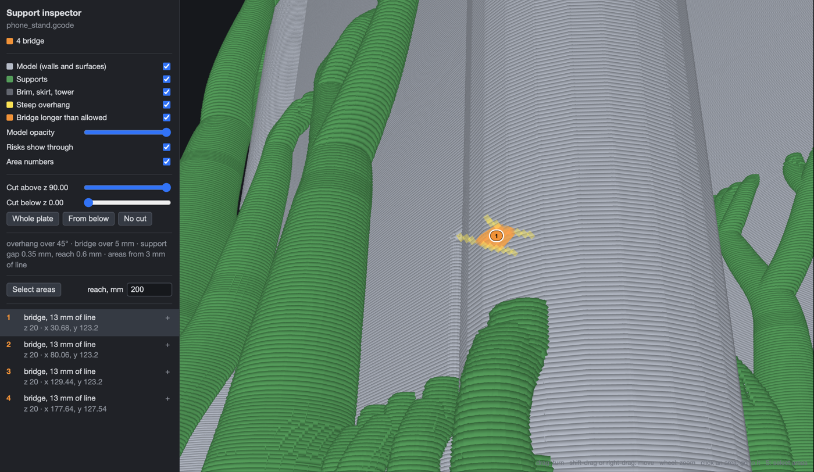

# 3D print support inspector

Finds the parts of a sliced print that nothing holds up, and shows them in a 3D viewer.

Painting an area for support, or switching supports on, does not mean a support ends up under it: the
slicer decides where the supports really go. So the inspector reads the slicer's result, the G-code,
and checks every printed line of the model against what lies directly below it.

Slicers warn about "floating regions" only when supports are off, and do not say where. With supports
on they say nothing, also when a support did not reach, was blocked, or was never generated under a
small feature. The inspector answers that one question: after slicing, is every line of the model
resting on something?

## Install

It needs Python 3.9 or newer.

    pipx install git+https://github.com/andtdev/3D_print_support_inspector

or `pip install git+https://github.com/andtdev/3D_print_support_inspector` in an environment of your
own. That gives the `support-inspector` command. Without installing: clone the repository and run
`./inspect` in place of `support-inspector` (macOS and Linux); its first run sets up a Python
environment with numpy and scipy in `.venv`.

## Use

    support-inspector plate.gcode
    support-inspector project.gcode.3mf      a sliced project exported from the slicer
    support-inspector project.3mf            not sliced yet: Bambu Studio or OrcaSlicer slices it first

A four-part, 8-hour plate takes about 10 seconds.

## Examples

To try it without a print of your own, download a report from `examples/` and open it in a browser.

**Supports on, and still something missed.** This is what the inspector is for.

[`examples/report_hanging_tip.html`](examples/report_hanging_tip.html): a roof on two pillars with
three small tips hanging down from it (`examples/hanging_tips.stl`), sliced in Bambu Studio with
supports on and "On build plate only". The picture shows the print cut at the tips' first layer,
seen from above ("Cut above z" at 11.2). Two tips lie on the supports. The middle one has a low
block of the model under it, where no support may stand: the supports leave a shaft there, and the
tip is printed into the air over it. Red: nothing below.

A real part, a link of a phone stand, sliced in Bambu Studio with tree supports all around it.
Inside, where the plate closes over a cut-out, a 4 x 3 mm patch has no support: 13 mm of printed
line with nothing under it. From the outside it sits behind walls and supports. The plate holds
four of these parts and the list has four entries, one per part.

[`examples/report_prusaslicer_supports.html`](examples/report_prusaslicer_supports.html) is a case
you can reproduce: `examples/test_piece.stl` sliced in PrusaSlicer with supports on. The ledge gets
supports, but its middle does not, and neither does the long bridge, because PrusaSlicer puts no
support under what it prints as a bridge.

**Supports off.** [`examples/report.html`](examples/report.html) is the same test piece sliced in
Bambu Studio without supports, the picture at the top: the ledge and the long bridge are reported,
the 4 mm bridge and the wall leaning 40° are not.

It prints the risk areas, writes `NAME.support_report.html` next to the input, opens it, and exits
with 1 when it found any area (0 when it found none), so a build script can stop on it:

    support-inspector plate.gcode --no-open || echo "something hangs"

## What it reports

Every line of the model is cut into 0.2 mm pieces. A piece is held when the model's previous layer
lies under it, or a support layer does within the support gap. The rest falls into three kinds:

| Kind | Colour | Meaning |
| --- | --- | --- |
| hanging | red | Nothing below: the line is printed into the air. |
| bridge | orange | Held at both ends, but spanning more than `--max-bridge`. |
| steep | yellow | Leans out over the layer below by more than `--max-overhang-angle`, with no support under it. |

Not reported: the first layer, bridges up to `--max-bridge` held at both ends, the infill and the skin
that lies on the infill inside the part, steep overhangs less than `--min-steep-height` tall (rounded
edges), and areas with less than `--min-length` of risky line.

## The viewer

One HTML file, no installation; it needs a browser with WebGL 2. It shows the model's walls and
surfaces, the supports and the risk areas, each with its number from the list.

- Click an area in the list or its number in the view to go to it, seen from below.
- Drag turns, shift-drag or right-drag moves, the wheel zooms.
- "Risks show through" draws the risk areas through everything in front of them.
- "Cut above z" and "Cut below z" hide layers; "Model opacity" makes the model see-through.
- `report.html#area=3` opens on area 3.

### Selecting and labelling areas

The viewer is also a way to annotate a print: select any parts of it, give each a label, and save
the result as a file. That is for telling someone else, or a program, or an AI assistant that is
editing the model, exactly where on the print something should change ("no support here", "this
edge hangs", "make this thicker"), with coordinates instead of a description.

1. Press "Select areas" (or S) and drag a box over the model. The box takes exactly the surface
   you see inside it: a ray goes from your eye through every point of the box and stops on the
   first thing it hits, model or support, so nothing behind is taken and nothing outside the box.
   "Reach" is how far from your eye the rays go (200 mm unless changed): zoom in, or raise it.
   More boxes add to the selection, alt-drag takes away, a click takes a small spot. The "+"
   beside a risk area selects that area. Right-drag and the wheel still move the view.
2. Type a label and press Enter or "Add". The area takes a colour and shows its label in the view.
3. "Save file" downloads `NAME.selections.json`; "Copy" puts the same text on the clipboard.

The file names the inspected file (name and full path) and lists each selection with its label, its
box (`min`, `max`, `size`, `center`, in mm in the plate's coordinates), the length of printed line
in it, the risk areas it touches and a sample of its points. The selections stay in the browser
when the report is reloaded, as long as it is of the same slice.

## Settings

| Option | Default | |
| --- | --- | --- |
| `--max-overhang-angle` | 45 | Degrees from vertical a wall may lean out before it counts as steep. 40 also reports unsupported 45° chamfers. |
| `--max-bridge` | 5 | mm a line may span through the air when both ends are held. |
| `--support-gap` | 0.35 | mm a support's top may lie below a line and still hold it. Set it a little above the slicer's top z distance. |
| `--support-reach` | 0.6 | mm a line may lie beside the nearest support line and still be held. |
| `--hang-fraction` | 0.8 | A line hangs when it lies this fraction of its width, or more, beside the nearest line below. |
| `--min-length` | 3 | mm of risky line an area needs to be reported. |
| `--min-steep-height` | 0.6 | mm of height a steep overhang needs to be reported. |
| `--ignore-steep` | | Report only hanging lines and long bridges. |
| `--check-infill` | | Check the infill too. |
| `--resolution` | 0.2 | mm, the length of the pieces. |
| `--plate` | 1 | Plate of a 3MF. |
| `--slicer` | Bambu Studio or OrcaSlicer, where found | The executable that slices a project that is not sliced. |
| `--layer-height`, `--line-width` | 0.2, 0.42 | mm, for G-code that does not say (Cura's). The layer height is then taken from the layers themselves where it can be. |
| `-o`, `--json`, `--no-open`, `--no-viewer`, `--viewer-infill` | | Output. |

`support-inspector --help` lists them all.

## Limits

- Tested on real slices of the test piece from Bambu Studio 2, OrcaSlicer 2.5, PrusaSlicer 2.9 and
  Cura 5.14, and on little else from the last three. If it gets a slice wrong, please open an
  issue with the G-code.
- PrusaSlicer puts no support under what it prints as a bridge (its "Don't support bridges"
  setting), so with supports on, a long bridge is still reported. That is what the G-code says.
- Text G-code only: not PrusaSlicer's binary `.bgcode` (switch "Supports binary G-code" off in the
  printer settings, or convert the file).
- One nozzle moving in flat layers: no non-planar or belt printing.
- It judges geometry, not printing: a line that is held may still print badly, for example on a
  support with a large z distance.
- The model in the viewer is drawn from the print's lines, without the infill.

## Tests

    pip install pytest
    pytest

They check a clean cube, a ledge with and without support, long and short bridges and leaning walls,
written as G-code in each slicer's comment style, and real slices of the test piece from Bambu Studio,
OrcaSlicer, PrusaSlicer and Cura, with and without supports.

## Licence

MIT, see `LICENSE`.
